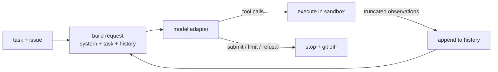

# PatchLoop

**A coding agent written from scratch (no agent framework) that fixes failing tests inside a locked-down Docker
sandbox. It's evaluated on a benchmark of bugs injected into real open-source libraries, and its tools are also
served over MCP.**

> GIF of a trajectory being replayed: _to record_. Open `results/oracle/viewer.html` or run `make demo`.

## Results

| run | model | toolset | tasks x trials | resolved (95% CI) | mean cost / task | date |
|---|---|---|---|---|---|---|
| oracle (harness check) | reverse-applies the bug | structured | 36 x 1 | 36/36 = 100% (90.4-100%) | $0 | 2026-10-23 |
| E1 baseline | claude-haiku-5-5 | structured | 36 x 1 | _target: not yet run_ | _target < $0.05_ | - |
| E2 interface ablation | claude-haiku-5-5 | bash_only | 36 x 1 | _target: not yet run_ | - | - |

All numbers are generated from `results/` by `patchloop report --all` into [docs/EVAL_REPORT.md](docs/EVAL_REPORT.md).
E1 and E2 need an API key and an approved pilot (`make eval-pilot RUN=E1`).

## How the loop works



- **One readable loop**: [`agent/loop.py`](src/patchloop/agent/loop.py) is 209 lines and grew out of [`seed/my_loop.py`](seed/my_loop.py).
- **Append-only history**: thinking blocks are replayed unchanged. Compaction asks the model for a progress summary and then starts a *fresh* list; it never edits history.
- **Budgets**: 40 steps, $0.15, 10 minutes and an 80K-token soft prompt limit. Every episode records one of these stop reasons: `submitted`, `step_limit`, `cost_limit`, `time_limit`, `model_refusal`, `loop_detected`, `error`.
- **Errors are observations**: tool failures go back to the model. 429/5xx/overloaded errors are retried with exponential backoff plus jitter, and each retry is logged.
- **Loop detection**: the same action 3 times in a row gets one nudge; 5 times stops the episode.
- **Provider-neutral**: there's a native Anthropic adapter (Haiku 5.5: adaptive thinking with `effort`, prompt caching, refusal handling), an OpenAI-compatible adapter for free tiers, and a scripted `FakeModel`.

## Sandbox design

| flag | prevents |
|---|---|
| `--network none` | data exfiltration, downloading anything, calling home |
| `--read-only` + `--tmpfs /tmp` | persistent changes outside the workspace |
| tests bind-mounted `:ro` | "fixing" the bug by editing tests |
| `--user 1000:1000` | root inside the container |
| `--cap-drop ALL`, `--security-opt no-new-privileges` | privilege escalation via setuid or capabilities |
| `--memory 1g --memory-swap 1g`, `--cpus 1` | memory bombs, starving the host |
| `--pids-limit 256`, `--init` | fork bombs, zombie build-up |
| `timeout -k 2 N` per command | hung commands |
| `--rm` + anonymous workspace volume + atexit cleanup | leftover containers and data |
| fresh `git init` after the bug is applied | reading the answer from `git log` / `git diff HEAD` |
| `_run_docker` argv assertion | agent commands ever running on the host |

All of this is tested in [`tests/integration/test_sandbox_security.py`](tests/integration/test_sandbox_security.py) and [`tests/unit/test_sandbox_unit.py`](tests/unit/test_sandbox_unit.py).

## Benchmark construction

- **Targets**: toolz 1.2.0 and boltons 26.2.0 (both BSD-3). Each test suite runs in under 2 s in the container. ([ADR-004](docs/DECISIONS.md))
- **Strategy A (syntax-tree mutations)**: flip a comparison, off-by-one in a `range`/slice, negate a condition, swap arguments, remove a guard clause, change a constant or default, swap `and`/`or`. Exactly one site is changed, and each mutated file is re-parsed.
- **Strategy B (LLM rewrite, in the spirit of SWE-smith)**: implemented in `benchgen/llm_rewrite.py`. It's opt-in because it costs API money, and it hasn't been run yet.
- **Validation**: the original repo must pass. The mutated repo must fail at least one test (FAIL_TO_PASS) while all the others pass (PASS_TO_PASS). Each candidate runs twice to rule out flakiness, identical diffs are de-duplicated, and bugs that break more than 25% of the suite are rejected.
- **Bug reports**: written from failing test names and a filtered failure excerpt only, never from the diff. A **leak check** rejects any report that names the mutated file, line or code.
- **Current benchmark**: 36 tasks (18 + 18). Mutation mix: compare_flip 7, swap_args 7, off_by_one 6, negate_condition 6, bool_op_swap 4, change_constant 4, remove_guard 2. In 15 of the 36 tasks, a failing test names the buggy function.
- **Limitations**: both libraries are almost certainly in the model's training data. The bugs are new, but familiarity with the original code helps. Synthetic single-line bugs are easier than real ones.

## Quickstart

```bash
make setup && make images
```

```bash
make demo
```

That runs a scripted FakeModel that fixes a toy bug inside Docker, with no API key needed. Then:

```bash
make test && make test-docker
```

```bash
make bench
```

```bash
make eval-smoke
```

`make bench` regenerates the 36 tasks with no API calls. `make eval-smoke` runs the runner, grader, report and viewer for free.

For a paid run (copy `.env.example` to `.env` and add your key first):

```bash
make eval-pilot RUN=E1
```

The pilot runs 3 tasks and prints the measured cost per task and the extrapolated total. Run `make eval RUN=E1` only after approving that cost.

## MCP demo

See [docs/MCP.md](docs/MCP.md) for Claude Code and Claude Desktop config, notes on MCP risks, and a recording checklist.

## How it was built

Implemented with Claude Code as a pair programmer, starting from a hand-written-style seed loop. Benchmark design, experiments and analysis by Varad.
