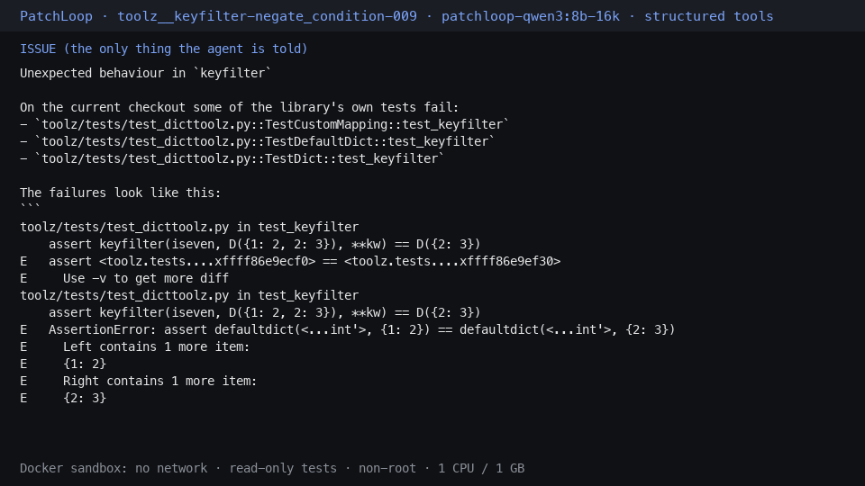
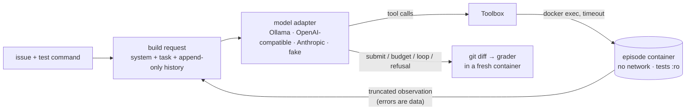

<h1 align="center">PatchLoop</h1>

<p align="center">
  <b>A coding agent written from scratch that fixes failing tests inside a locked-down Docker sandbox,<br/>
  evaluated on bugs injected into real open-source libraries, with its tools also served over MCP.</b>
</p>

<p align="center">
  <a href="https://github.com/varad-oss/patchloop/actions/workflows/ci.yml"></a>
  
  
  
  
  <a href="LICENSE"></a>
</p>

<p align="center">
  
  <br/><sub>A real episode replayed from its trajectory: the local 8B model finds and fixes an inverted condition in
  <code>toolz.keyfilter</code> in 19 steps, and the grader confirms it in a fresh container.</sub>
</p>

## Why

Coding agents are usually built on a framework, so the loop is a black box: how the agent recovers from errors, when
it stops, what it costs and what it can touch are hidden. PatchLoop is the whole thing, small enough to read:

1. **the agent loop is about 200 readable lines** with no agent framework: budgets, retries, loop detection,
   context compaction and a trajectory log are all visible code;
2. **model-written commands never touch the host**: every tool call runs in a disposable container with no network,
   read-only tests and resource limits, and the boundary is tested;
3. **every claim is measured** on a benchmark built by injecting validated bugs into two real libraries, with
   confidence intervals and a paired significance test.

Everything runs locally for free: no API keys and no paid services.

## Results

72 episodes (36 tasks × 2 toolsets), local `qwen3:8b` via Ollama with thinking off, on an Apple M5 laptop,
2026-10-23/24. 95% Wilson intervals in brackets. Full report: [docs/EVAL_REPORT.md](docs/EVAL_REPORT.md) ·
annotated failures: [docs/EVAL_ANALYSIS.md](docs/EVAL_ANALYSIS.md) · raw data: [`results/`](results/).

| Run | Toolset | Resolved | Edited the buggy file | Mean time / task | Cost |
|---|---|---|---|---|---|
| **E1** | structured: `search`, `view_file`, `str_replace`, `run_tests`, `bash`, `submit` | **12/36 = 33.3%** [20, 50] | 20/36 | 240 s | $0 |
| **E2** | `bash` + `submit` only | **3/36 = 8.3%** [3, 22] | 10/36 | 308 s | $0 |
| oracle | reverse-applies each injected bug (harness check) | 36/36 = 100% | — | — | $0 |

<p align="center">
  <picture>
    <source media="(prefers-color-scheme: dark)" srcset="results/resolve_rates-dark.svg">
    
  </picture>
</p>

**What it shows**
- **The interface matters for a small model.** On the same 36 tasks, 11 were solved only with the structured
  toolset and 2 only with bash (exact McNemar test, **p = 0.022**).
- **Finding the bug isn't the bottleneck; committing to a fix is.** Every episode reached the buggy file. With
  `str_replace` the model edited it in 20/36 episodes; with raw bash, in 10/36. Most failures end with an empty patch.
- **Context resets hurt.** Episodes that needed compaction resolved 4/22 versus 8/14 without (E1). One trajectory
  shows the model re-reading the same file after each reset. That's correlation, not proof.
- **Thinking mode is impractical on a laptop GPU**: with qwen3's thinking on, 0/5 tasks resolved, and every episode
  ran out of its 15-minute budget after 6–17 steps.

These are results for an 8B local model, not a frontier model: absolute rates aren't comparable to published agent
benchmarks, and the toolset effect is model-dependent (strong models often do fine with bash alone).

## How it works



- **One readable loop.** [`agent/loop.py`](src/patchloop/agent/loop.py) is a single `for step in range(max_steps)`
  with every exit going through one `finish()`. Stop reasons: `submitted`, `step_limit`, `cost_limit`, `time_limit`,
  `model_refusal`, `loop_detected`, `error`.
- **Append-only history.** The provider's raw assistant content is replayed byte-for-byte, which keeps prompt caches
  warm and thinking blocks valid. When the prompt nears its limit, the model writes a progress summary and the loop
  starts a *fresh* list; it never edits history.
- **Failure modes handled in code.** Transient API errors are retried with backoff and jitter. Tool errors and
  malformed calls go back to the model as observations. The same action 3 times in a row gets a nudge, and 5 times
  stops the episode. Every observation is truncated with an explicit marker.
- **An interface designed for the model.** `str_replace` requires a unique exact match. When it fails, it shows the
  most similar region of the file so the model can copy it instead of re-typing code from memory
  ([ADR-012](docs/DECISIONS.md)).

Line-by-line walkthrough: [docs/learning/LOOP_WALKTHROUGH.md](docs/learning/LOOP_WALKTHROUGH.md) · diagrams:
[docs/ARCHITECTURE.md](docs/ARCHITECTURE.md) · design records: [docs/DECISIONS.md](docs/DECISIONS.md).

## Sandbox

| Protection | What it prevents |
|---|---|
| `--network none` | exfiltration, downloads, calling home |
| `--read-only` root + `--tmpfs /tmp` | persistent changes outside the workspace |
| tests bind-mounted `:ro`; grader rejects edits to `conftest.py` and pytest config | "fixing" the bug by changing the tests |
| `--user 1000:1000`, `--cap-drop ALL`, `no-new-privileges` | root, setuid and capability escalation |
| `--memory 1g`, `--cpus 1`, `--pids-limit 256`, `--init` | memory and fork bombs, zombie build-up |
| `timeout -k 2 N` per command | hung commands |
| fresh `git init` after the bug is applied | reading the answer from `git log` or `git diff HEAD` |
| a single `docker` choke point that asserts its argv | agent commands ever running on the host |

All of it is tested against a real container in
[`tests/integration/test_sandbox_security.py`](tests/integration/test_sandbox_security.py).

## Benchmark

- **Targets:** [toolz](https://github.com/pytoolz/toolz) 1.2.0 and [boltons](https://github.com/mahmoud/boltons)
  26.2.0 (both BSD-3), pinned by commit. Each full test suite runs in under 2 s ([ADR-004](docs/DECISIONS.md)).
- **Strategy A, syntax-tree mutations:** flip a comparison, off-by-one, negate a condition, swap arguments, remove a
  guard, change a constant, swap `and`/`or`. One site per bug, spliced into the original formatting.
- **Validation:** the original passes; the mutated repo fails specific tests (FAIL_TO_PASS) while the rest pass
  (PASS_TO_PASS), identically on two runs; duplicates and bugs breaking over 25% of the suite are rejected.
- **Bug reports** are written from failing test names and assertion output only, never from the diff. A leak check
  rejects any report that names the file, the line or the changed code.
- **36 tasks** (18 per library). **Strategy B** (a model rewrites a function with one subtle bug) produced 6 more
  validated tasks with the local model, in [`bench/tasks_llm/`](bench/tasks_llm/). They aren't evaluated yet
  ([ADR-013](docs/DECISIONS.md)).

## Quickstart

Requirements: Docker, [uv](https://docs.astral.sh/uv/), and [Ollama](https://ollama.com) for real-model runs.

```bash
git clone https://github.com/varad-oss/patchloop.git && cd patchloop
make setup && make images       # Python env + sandbox images (a few minutes, once)
make demo                       # a scripted model fixes a toy bug in the sandbox; no model needed
```

Run the real agent on the benchmark, for free:

```bash
make local-model                # pulls qwen3:8b (~5 GB) and builds the 16K-context variant
make eval-local RUN=E1          # 36 tasks, about 2.5 h on an Apple M5
make progress                   # live progress bar, current step and time left
```

`patchloop` commands below assume the environment is active (`source .venv/bin/activate`).
Then `patchloop report --run-id E1` writes a summary and `results/E1/viewer.html`, a page with every step of every
episode. With an Anthropic key in `.env`, `make eval-pilot RUN=E1 MODEL=claude-haiku-5-5` measures the cost on 3
tasks before anything larger runs.

## Reproducing the numbers

| Command | What it does | Time |
|---|---|---|
| `make test` | 103 unit tests (no Docker, no model, no network) | seconds |
| `make test-docker` | 17 sandbox-security, end-to-end and MCP tests against real containers | ~20 s |
| `make bench` | regenerates and validates the 36 tasks (no model) | a few minutes |
| `patchloop eval --model oracle --run-id oracle` | harness check: must resolve 36/36 | ~3 min |
| `scripts/run_local_experiments.sh` | thinking-on check, then E1 and E2 on local qwen3 | ~7 h |
| `patchloop report --all` | regenerates [docs/EVAL_REPORT.md](docs/EVAL_REPORT.md), the chart, and the viewers from `results/` | seconds |
| `patchloop replay` | renders a trajectory as the GIF above | seconds |

## MCP server

The same sandboxed tools are available to any MCP client, such as Claude Code or Claude Desktop, built on the
official Python SDK v2: `bash`, `view_file`, `search`, `str_replace`, `run_tests` and `diff`. Each session gets its own
container, created lazily and removed when idle.

**On your own Python project.** Prepare it once, then add the server. This builds a sandbox image of the repo with its
dependencies, which takes a minute or two the first time:

```bash
patchloop mcp-prepare ~/code/myproject
claude mcp add patchloop -- "$(pwd)/.venv/bin/patchloop-mcp" --repo ~/code/myproject
```

The model works on a **copy** of your repo inside the container, with no network and your tests read-only. Your files
are never modified: `diff` returns the changes as a patch, and you review it and apply it with `git apply`. `.git`,
virtualenvs and `.env` files are never copied into the image.

Scope: Python projects with a pytest suite (`tests/`, `test/` or `<package>/tests`, or set `--tests-dir`); dependencies
from `pyproject.toml`, `setup.py` or `requirements*.txt`. Docker is required. Packages that need system libraries
outside `python:3.12-slim` may fail to build. Re-run `mcp-prepare` after you change the code yourself.

**Without `--repo`** the server opens a built-in demo: a toy repo with one planted bug in `median()`.

**Recorded demo:** [docs/MCP_DEMO.md](docs/MCP_DEMO.md) shows Claude Code, with all built-in tools disabled, fixing
the toy bug through the server in 8 turns, and being refused (`Read-only file system`) when it tries to edit a test.
Config for Claude Desktop, a risk analysis (tool poisoning, over-broad permissions) and the reproducible demo command:
[docs/MCP.md](docs/MCP.md).

## Project structure

```
src/patchloop/
  agent/        loop.py (the loop) · models.py (adapters, pricing) · tools.py (6 tools)
                context.py (compaction) · prompts.py · trajectory.py (JSONL)
  sandbox/      docker_env.py (one locked-down container per episode) · images/ (Dockerfiles)
  benchgen/     mutators.py (strategy A) · llm_rewrite.py (strategy B) · validate.py · issues.py · build.py
  evals/        runner.py · grader.py · metrics.py · report.py · replay.py · viewer/
  mcp_server/   server.py
bench/tasks/    the 36 benchmark tasks      bench/tasks_llm/   strategy-B tasks
results/        committed episodes and trajectories behind every number
docs/           report, analysis, architecture, decisions, MCP, learning notes (M0-M7)
tests/          unit/ (offline) and integration/ (Docker)
```

## Limitations

- **One small local model.** Results are for qwen3:8b, one trial per task; intervals are wide.
- **Synthetic bugs.** Mostly single-line mutations, easier to localize than real-world bugs.
- **Contamination.** Both libraries are surely in the model's training data. The bugs are new, but the original
  code is familiar.
- **Template bug reports** read like CI logs. A review of 10 found all reproducible and leak-free, but 6/10 titles
  name test functions rather than real APIs ([review](docs/project/BUG_REPORT_REVIEW.md)).
- **Docker is the isolation boundary.** A kernel or container-runtime escape would defeat it; a microVM (gVisor,
  Firecracker) would be stronger.

## Roadmap

- Evaluate the strategy-B tasks, and grow them past 10 with a stronger model.
- Best-of-k with test-based selection, reported as pass@k and pass^k (implemented, not run).
- Repeat E1/E2 with a stronger model to test whether the interface effect shrinks.
- Real-bug tasks mined from the libraries' own history.
- More natural bug reports: titles from real API names, and LLM-written prose behind the same leak check.

## Credits

Built by Varad Rajiv Pandare, with Claude Code as a pair programmer, from my specification and under my direction.
Benchmark design, experiments and analysis are mine.

Ideas drawn from [SWE-bench](https://www.swebench.com) (FAIL_TO_PASS / PASS_TO_PASS grading),
[SWE-agent](https://github.com/SWE-agent/SWE-agent) (agent-computer interface design),
[mini-SWE-agent](https://github.com/SWE-agent/mini-swe-agent) (linear history, stateless bash) and
[SWE-smith](https://github.com/SWE-bench/SWE-smith) (LLM-rewrite bug generation).

## License

[MIT](LICENSE)
