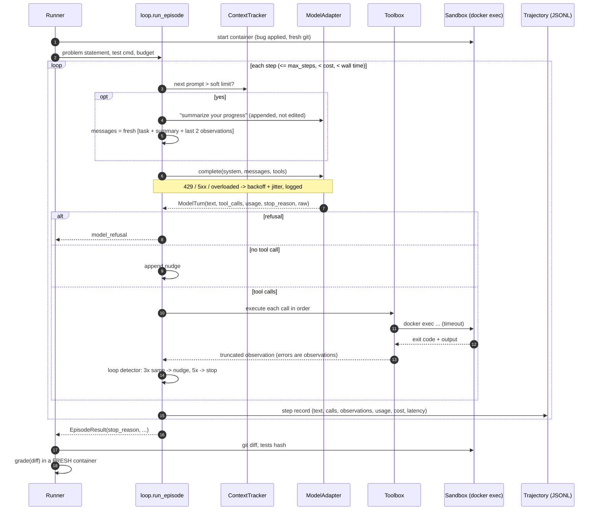
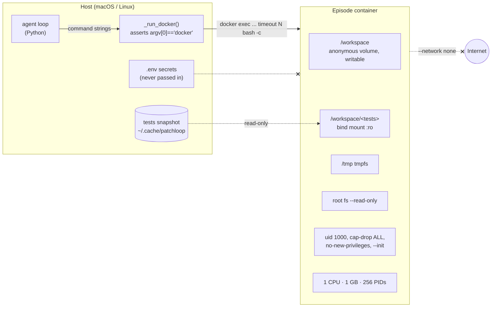
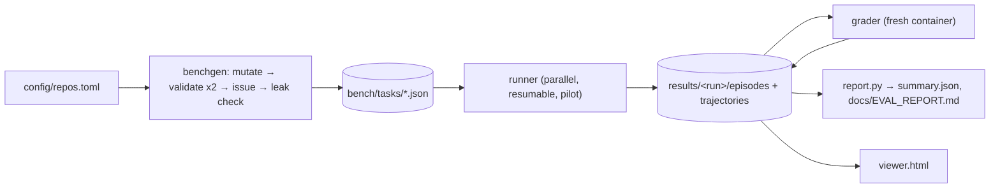

# Architecture

```
src/patchloop/
  agent/     loop.py (the loop) · models.py (adapters, pricing) · tools.py (6 tools) · context.py (compaction)
             prompts.py · trajectory.py (JSONL)
  sandbox/   docker_env.py (one locked-down container per episode) · local_env.py (--unsafe-local, toy only)
  benchgen/  mutators.py (strategy A) · llm_rewrite.py (strategy B) · validate.py · issues.py · build.py
  evals/     runner.py · grader.py · metrics.py · report.py · viewer/render.py
  mcp_server/server.py
```

## The loop (one episode)



## The sandbox boundary



## Data flow for an experiment


